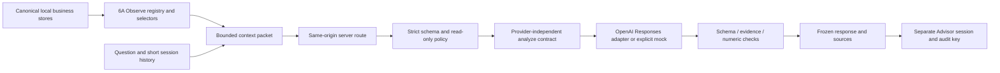

# Advisor architecture — BUILD 6B

- Browser: `lib/agent/advisor/context.ts`, `components/advisor/page.tsx`, `lib/advisor-storage.ts`. Server has no localStorage access.
- Server: `app/api/advisor/route.ts`, `config.server.ts`, `providers/openai.server.ts`. Provider secrets and versioned instructions do not appear in production client assets.
- Shared pure contracts: `types.ts`, `policy.ts`, `prompt.ts`, `validation.ts`, `service.ts`. Only limits/version are required in browser code; unused prompt/provider exports are removed from the client build.
- Observe capability gates reuse Build 6A permissions. Selected KR/process records and explicit links produce compact projections, never raw module stores. Entity selection errors do not quietly broaden the packet.
- Authority remains Observe/Recommend. No executor, proposal, approval or domain mutation path is available from Advisor. Existing Build 6A dry-run lab is a separate surface.
- Numeric grounding checks require claimed numbers to be present in cited records (with million/billion normalization). Known IDs and valid syntax do not prove causal or semantic support; manual review and live-model evaluation remain necessary.
- Context is supplied by the browser and validated structurally. It is **not authenticated or independently verified business data**. Never treat this local prototype as a multi-tenant trusted server source.
- Current session is stored under `growth-engine.advisor.v1`; Build 6A uses `growth-engine.agent.v1`. Corrupt data is not overwritten; save conflicts surface to the user. Messages/audit are bounded to 24/120. Each response freezes its evidence. Follow-up history is limited to six messages with 1,200 characters each.
- Request budget: 2,000-character question, 20 evidence records, 10 entity refs, three history points; 32 KB packet and 48 KB HTTP body. Output up to 2,200 tokens and 25-second provider timeout. No streaming, tools, automatic retries or background work.
- Same-origin validation compares Origin to the actual Host header because Next normalizes local request URLs. Custom client header and JSON body are required. Rate protection: 12 validated requests per minute per running server process; bounded timestamp list, no session spoof bypass of that process limit. This is local abuse protection, **not authentication or a distributed quota**.
- `AGENT_MODEL_PROVIDER=none` is the default. Mock is explicit. `openai` requires a nonempty server key; browser cannot choose endpoint, secret, prompt, model, system role or tools. GET status returns only configuration status, not proof that an external call succeeded.
- Audit does not contain model credentials, provider bodies, raw headers or private reasoning. Successful responses include provider/model/prompt/version/time. Failed invocations can report a safe `modelCalled` boolean.

Real LLM acceptance remains pending local credential configuration. Unit/transport tests and mock browser QA are deliberately reported separately from a live external API test. Before any public deployment, add appropriate authentication, tenant authorization, deployment-aware origin handling and server-verified context; none is implied by this localhost prototype.
