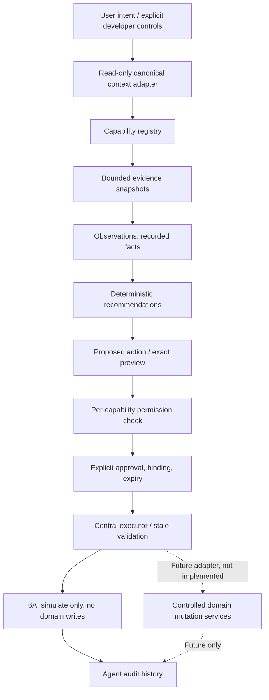

# Agent architecture — final local v1 (Builds 6A–6G)

Growth Engine by 1 Minute Manager. Provider-independent deterministic foundation. BUILD 6E adds separately confirmed, whitelisted local domain creates and verified audit; 6F composes the workspace and 6G hardens boundaries and release validation. No autonomous write adapter, backend authentication, embeddings, or background worker was added. Earlier sections retain historical build boundaries; the final v1 section below describes current behavior.

## Final Agent v1 architecture — BUILD 6G

Business OS Data → Canonical Selectors → Agent Context → Evidence → Signals → Patterns → Diagnosis → Recommendation → Draft → Approval → Explicit Execution → Domain Validation → Verification → Audit → Management History.

The model operates only inside bounded analysis/wording boundaries. The optional server provider has no execution tools. Workspace text intent opens explicit review UI; preparation templates and all business writes remain deterministic. Only the central executor invokes existing canonical domain services for eight allowlisted creates. All sixteen preparation templates remain validated; preparation-only and High/Critical operations do not execute.

The current implementation requires exact revision/payload/context/evidence approval binding, current source, valid owner/links/active cycle and permissions. Authorization is rechecked immediately before commit. Persisted Executing journal precedes mutation; stable command/entity IDs and actual entity rereads support idempotent retries and post-mutation recovery. Completed bindings and historical evidence remain frozen. These are recoverable local browser operations, not atomic multi-key transactions or distributed locks.

Evidence identity is source/value sensitive. Provider history is bounded to the same explicit subject; context/session changes cancel pending requests and mismatched responses are discarded. Unknown metrics remain explicit data gaps. Source text is untrusted evidence, never authority. Missing artifacts are labeled unavailable, duplicate references fail closed and actual rejection reasons appear in history.

The preparation version-1 store optionally encodes identical duplicate snapshots using `compact-snapshots-v1`; reads restore the exact canonical snapshots before normal validation and binding checks. Old formats remain readable without rewrite. Different snapshots are retained; unknown encoding fails closed. Corrupt/quota/conflicting writes preserve previous raw storage. The internal 8 MB limit does not guarantee that an actual browser permits 8 MB.

Compensation is limited to an unchanged/unlinked created GrowthIdea, archived by the original actor/organization with permission. No destructive rollback, generic store restore, autonomous action or new provider access was introduced. Every normal Agent mutation has journal/audit evidence, but local storage cannot make audit durable or tamper-proof.

Validated baseline: 847 tests, TypeScript, production build and 67 HTTP route/asset/API checks. Browser golden path and local two-tab stale protection passed. No real provider key was configured, so live-provider smoke remains untested. See [BUILD-6G.md](BUILD-6G.md) for the 40-point release report, measurements, actual browser coverage and limitations. Local prototype v1 is ready within its stated scope; production requires authenticated server authorization, durable persistence/audit and transaction/concurrency guarantees.

## Boundaries and flow

`lib/agent/types.ts` defines domain, authority, risk, evidence, observation, recommendation, proposal, approval, execution, audit, context and future provider/tool interfaces. `capabilities.ts` is the code-defined registry and permission policy. `context.ts` reads through existing parsers, `readScaleSources`, System `commandReport`, Strategy `getStrategyDashboard`, Scale `getScaleDashboard`, and canonical KR calculations. `selectors.ts` adapts the System report. `orchestrator.ts` controls read/draft calls and three rules. `actions.ts` owns lifecycle, approval, deterministic comparison and dry-run execution. `lib/agent-storage.ts` owns the separate storage port; core files never call `localStorage.setItem`. `components/agent/lab.tsx` supplies the explicit developer controls.

## Authority and permissions

Observe reads only. Recommend creates recommendation/evidence artifacts. Prepare produces context drafts; it never invokes a domain mutation. Execute is reachable only through the proposal/approval/executor path. Permission is an exact capability + authority allowlist entry; user rights do not authorize autonomous writes. Registry enabled flags and permission checks apply centrally, including at execution time.

All eleven write contracts use AlwaysRequired. KR target, stopping experiments, cancelling objectives, primary constraint, Scale decisions, process ownership and SOP approval remain sensitive. Delete and StructuralChange map to Critical/AlwaysRequired and are not registered execution capabilities. The central never-autonomous catalogue also includes baseline, active/next cycles, important archives and organization structure. There is no fallback arbitrary function dispatch.

The 6A write payload intentionally stays a mock contract `{entityId, value}` with action-specific validation. Creation capabilities use an existing context entity as a mock anchor; they do not create objects. The future live adapter must replace these minimal mock payloads with complete domain-specific schemas and reuse domain services and domain compare-and-swap transactions before it can be enabled. No live adapter is present.

## Evidence and context

Evidence records a source selector, domain, type, compact value, route, optional reference and timestamp. Historical records and learning evidence remain distinct from current metrics. Missing data stays unknown. The active Strategy summary never silently substitutes an old cycle; current entity inspection can still reference an existing non-archived review cycle and clearly exposes the absence of an active cycle.

The System score is the canonical `commandReport.health.score`, not an invented average. Process health/founder dependency and reliable ownership are read through existing System calculations. Scale evidence maturity, capacity risks, primary constraint and selected funnel use the existing dashboard. Read capability results are compact projections or explicit missing/null values. `getProcessKPIs` projects canonical KPI scores/trends, not invented values. Weekly trend exposes up to three canonical periods with date, progress, confidence and main risk, without copying review histories.

Packets cap evidence at 24, unique entity references at 12 and historical summaries at three. KR/Process/Constraint/Experiment/Objective context type aliases share the generic packet envelope; selected context filters evidence by domain and entity identifier. Business summary is separate from the full source stores. The adapter temporarily holds minimal entity projections to check current state, but these are not persisted as a full store replica.

Evidence used by a recommendation or proposal is copied into Agent storage. Preparing an action additionally records the exact selected entity's current-state evidence. Later source refreshes do not overwrite those artifacts. Confidence is evidence strength; no success probability or hidden chain-of-thought is recorded.

The three deterministic rules are deliberately small: (1) a linked high-weight off-track KR, constraint, positive completed experiment and founder-dependent process; (2) strong/repeatable aggregate growth evidence plus capacity risk; (3) missing growth/readiness evidence. A rule creates nothing if its prerequisites do not match. Cross-module evidence is cited only when the links actually exist. No free-form business text is executed as an instruction.

## Approval and execution

Draft → ReadyForApproval → Approved / Rejected → Executed (dry-run) or Failed. Requests expire after 24 hours. Approval binds canonical proposal metadata, payload, affected refs, risk, expected state and frozen evidence. Canonical serialization omits undefined object keys consistently across JSON persistence. Editing any bound field requires a new approval; rejected, expired, failed and already simulated proposals cannot execute.

Executor order: capability and enabled flag → exact permission → contract metadata → valid approved request and binding → affected entity match → fresh entity lookup and exact expected-state comparison → payload validation → dry-run result → audit. Actual business state is re-read on every operation. Changed target/current/baseline/type/update timestamp causes stale failure. A UI conflict button overrides only the executor's temporary read projection; it does not change any domain key.

`Executed` means simulation in 6A and is always accompanied by `dryRun: true`, explicit Persian labels and audit/result text stating no business mutation. There is no route to a real mutation. Duplicate execution produces a controlled failure, not a second success audit.

## Persistence and failure recovery

Key: `growth-engine.agent.v1`. Version 1 stores observations, recommendations, proposals, approval requests, audit records and their necessary evidence snapshots. Registry/permissions live in code; source module stores, histories, raw prompts and chat sessions are not copied. The adapter validates structures and references, enforces a 2 MB serialized limit and per-list limits, and checks the previous raw value before saving. Cross-tab conflicts block saving rather than overwrite.

Malformed Agent storage stays untouched and produces a recovery notice. The explicit reset control replaces only this development key. Source parse failures produce unknown values/notices; they never seed, overwrite, migrate or repair business stores. Local storage is not a security boundary: future backend execution will require authenticated authorization, durable atomic transactions and server-side approval verification.

## Future provider/tool boundary

`AgentModelProvider` is a type only, with no provider implementation. `AgentTool` has a controlled input schema, permission, risk, approval requirement and result envelope. Any future model may propose artifacts but cannot approve them, mutate the registry or call domain writes directly. Business text is untrusted data, distinct from instructions; future prompts need explicit data delimiters, allowlisted tools, structured output validation and the same central checks. No hidden reasoning should be persisted or exposed. A real tool adapter must use existing domain services, never direct browser storage writes.

## BUILD 6C diagnosis pipeline

Evidence → Signal → Pattern → Diagnosis → Recommendation.

`lib/agent/diagnosis/source.ts` projects canonical selectors into frozen evidence and independently identified signal families. `rules.ts` combines explicitly connected entities. `engine.ts` collapses risk patterns at their primary entity, reconciles lifecycle/history, and ranks at most three priorities. `freshness.ts` reads source revisions and relevant fields without selector execution. `hybrid.ts` accepts four wording fields only; severity, confidence, affected entities, evidence and priorities remain deterministic.

Storage is additive under `growth-engine.agent.diagnosis.v1` and preserves 6A/6B artifacts. Only an explicit manual scan runs diagnosis rules. Missing or stale sources are not evidence of resolution. History snapshots retain previous evidence when current facts change. See BUILD-6C.md for the registry, QA evidence and prototype limitations.

## BUILD 6D preparation pipeline

Evidence → Signal → Pattern → Diagnosis → Recommendation → Action Option → Draft → Approval. Execution remains future.

`lib/agent/preparation` separates read-only context projection, deterministic recommendations/plans, sixteen draft templates, pure validation, lifecycle/revisions/approval binding, and an optional local wording adapter. The detail UI previews proposed fields and blocks approval for missing input, stale evidence, absent permissions, or unapproved plan dependencies. Each step is separately reviewed. Approval means conceptual acceptance only, never domain completion.

Storage is additive under `growth-engine.agent.preparation.v1`. Raw-value compare-and-swap, structural/reference validation, bounded storage, and safe corrupt/quota handling preserve prior values. System, Strategy, Scale and earlier Agent stores are read-only to this layer. An approved action is not executable in 6D; edits or changed sources expire its approval. Explicit preview rebuild retains user-edited fields and rebinds current recommendation/evidence. All future changes use AlwaysRequired approval, including low-risk proposals.

Models cannot determine entity IDs, metrics, targets, risk, authorization, or approval. 6D has no new external-model transport; deterministic templates work without a provider. Local browser storage and freshness fingerprints are prototype conflict/freshness aids, not production authorization or durable transaction boundaries. Formal execution adapters, actual prerequisite completion checks, and server enforcement belong to 6E. See BUILD-6D.md for the full 38-point completion report, test evidence, and limitations.

## BUILD 6E — explicit domain execution

The current end-to-end flow is **Evidence → Signal → Pattern → Diagnosis → Recommendation → Draft → Approval → Execution → Verification → Audit**. Earlier sections describe their historical build boundaries: 6A still simulates; 6D still prepares; only the separate 6E executor performs real whitelisted creates.

`lib/agent/execution/{types,registry,adapters,engine}.ts` separates the command contract, eight executable create capabilities, canonical domain adapters and central validation/transaction orchestration. The user must approve the exact revision, run a pure dry run and separately confirm execution. Model wording never approves or executes. Approval expiry, permission, low/medium risk, entity anchoring, current source state, active Strategy cycle and actual successful prerequisite results are checked before mutation and rechecked at commit.

Adapters reuse System measurement, Strategy and Scale mutation/persistence services. The Agent does not directly write business storage. Stable action command IDs and created entity IDs provide local idempotency. The journal is persisted before the single-domain commit; the real entity is reread and verified before Succeeded. Explicit retry checks an existing exact result before replaying a mutation. This is recoverable browser orchestration, not an atomic multi-key or distributed transaction.

`growth-engine.agent.execution.v1` is additive and leaves prior Agent keys intact. It stores bounded records, minimal approved-field snapshots, result references, rollback metadata and append-only audit. Immutable completed records preserve the original approval and command. Corrupt, quota-limited or conflicting storage fails closed without generic store replacement. `components/advisor/execution.tsx`, `/advisor/actions/history` and `/dev/agent` show current journal results and recovery controls.

Only an unchanged, unlinked created GrowthIdea supports compensating archive. No deletion or whole-store snapshot restore is enabled. Other actions show unsupported rollback explicitly. High/Critical, owner changes, target updates, cancellations and preparation-only decisions remain non-executable. All plan steps are individually gated; conceptual approval is not predecessor completion.

Local actor/organization/permission hooks remain prototype contracts. Production requires authenticated server authorization, durable approval and journal persistence, real transactional boundaries and multi-client locks. See [BUILD-6E.md](BUILD-6E.md) for the 39-point report, 746-test result, browser evidence and remaining limitations.

## BUILD 6F — unified user experience

**Business Context → Conversation → Evidence → Diagnosis → Recommendation → Draft → Approval → Execution → Result → Management History** is the current user-facing flow.

`/advisor/workspace` composes the existing 6B–6E layers; `/advisor/history` aggregates actual session, diagnosis, rejection, execution and compensation records. Pure workspace intent routing returns review controls rather than mutation commands. Text approval and execution cannot bypass explicit confirmation, revision bindings, freshness or central permission checks. The executable whitelist remains exactly the eight 6E create capabilities.

The additive workspace store holds explicit contexts, bounded messages/evidence and artifact IDs. Canonical diagnoses, recommendations, drafts and execution results remain in their existing stores. Oversized diagnosis evidence is projected into bounded conversational snapshots; complete originals remain available in diagnosis history. Old Advisor sessions are imported once without rewriting earlier keys. Context remains explicit across follow-up questions, refresh and source-page navigation.

The existing provider transport remains optional and bounded. Deterministic offline workflows stay available. No new dependencies, autonomy, notifications, integrations, RAG or authority are added. Local persistence remains a prototype conflict/recovery mechanism, not server authorization or a durable transaction boundary. See [BUILD-6F.md](BUILD-6F.md) for the 36-point report, verification evidence and limitations.
