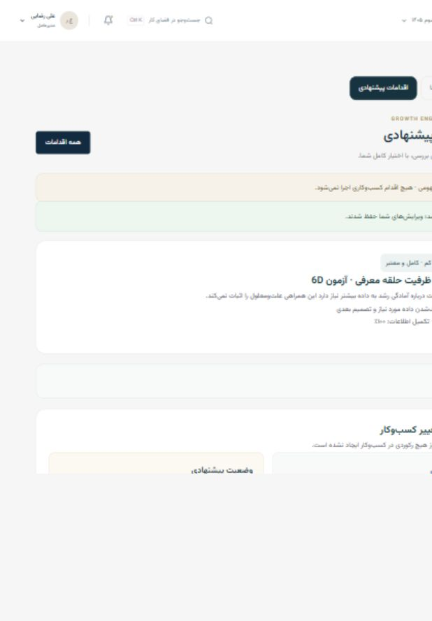

# BUILD 6D — Recommendation and approval preparation

Growth Engine by 1 Minute Manager. Verified 2026-10-06. This build prepares reviewable Agent artifacts; it does not execute business changes. The deterministic workflow is implemented. A new external-model wording connection was not added (see items 21 and 36).

## Completion report — 38 requested points

1. **Recommendation architecture.** `lib/agent/preparation` reads canonical source projections and existing 6C diagnoses. Evidence → Signal → Pattern → Diagnosis → Recommendation → Action Option → Draft → Approval. Execution remains future. `context.ts`, `recommendations.ts`, `templates.ts`, `validation.ts`, `engine.ts`, `wording.ts`, and `types.ts` separate these responsibilities.
2. **Recommendation types.** The model declares Investigate, ImproveProcess, ChangeOwnership, Standardize, Experiment, AdjustStrategy, CollectData, PrepareCapacity, ReduceRisk, ScaleOpportunity, and Monitor. Current deterministic branches emit CollectData, Standardize, Experiment, or ScaleOpportunity; all eleven are not separate implemented rule families.
3. **Action Options.** Recommendations contain three explicit options with capability, risk, reversibility, prerequisites, expected impact, and evidence. Generating recommendations does not automatically create drafts.
4. **Primary recommendation logic.** Low-confidence/data-quality findings prioritize collecting evidence. Capacity/process-readiness findings prioritize standardization. Opportunities prioritize scale preparation. Strategy findings propose an initiative, decision, or experiment. The primary choice includes a reason; correlated evidence is never presented as certain causation.
5. **Action Plan model.** Plans contain individually identified ordered steps, template IDs, dependency IDs, completion conditions, and optional proposed-action links. Statuses are Draft, ReadyForReview, ApprovedConceptually, and Archived.
6. **Draft model.** PreparedAction extends the existing proposal contract with template, field provenance, source snapshots, validation, risk, reversibility, revision, origin, recommendation/diagnosis references, and dependencies. There is no Executed status in this lifecycle.
7. **Draft templates.** Sixteen templates: Improvement, SOPChange, OwnerChange, KPI, Objective, KR, Initiative, StrategyDecision, GrowthIdea, Experiment, ConstraintUpdate, ScalePreparation, DecisionNote, ActionPlan, KRTargetChange, CancelObjective. The registry defines field schemas and authoritative risk/capability metadata.
8. **System drafts.** Improvement and KPI drafts reuse canonical creation shapes and validators. OwnerChange and SOPChange are review proposals; they do not assign owners or create a formal SOP version. Owner selection requires an actual role with an active person.
9. **Strategy drafts.** Objective, KR, and Initiative reuse real cycle/objective/KR references and creation validation. KR confidence uses the canonical 1–10 range and actual weight mode. StrategyDecision is conceptual, not a weekly-review mutation. KRTargetChange and CancelObjective require explicit input and stronger risk labels.
10. **Scale drafts.** GrowthIdea, Experiment, ConstraintUpdate, and ScalePreparation use selected actual entities. Experiment metric/baseline are resolved only from connected sources. ConstraintUpdate does not change the primary constraint; preparation does not mark capacity ready.
11. **Executive drafts.** DecisionNote records a suggested decision and review condition. It requires no invented business owner and creates no decision in domain storage.
12. **Cross-module plans.** The capacity sequence is SOP → ownership → growth experiment → initiative linked to the actual Revenue KR when available. Low-confidence plans collect evidence before defining a KPI. Missing connections remain input requirements. These are template-based plans, not an exhaustive planning optimizer.
13. **Field resolution.** Actual entity IDs and labels come from canonical source projections. Roles must have active people. Metric/baseline resolution follows exact experiment/measurement connections and retains source/date. AgentSuggested and UserEdited provenance are visible. Draft codes are explicitly proposal metadata.
14. **Missing-input handling.** Unknown owners, dates, units, baselines, targets, success criteria, or entity references remain blank/NeedsUserInput. Completeness and validation block approval preparation until required input is supplied. No fabricated targets or baseline values.
15. **Domain validation reuse.** Central validation reuses System, Measurement/KPI, Strategy/objective/KR/initiative, and Scale/experiment/preparation validators through isolated read projections. Pure validation never invokes a domain write or the 6A dry-run executor. Unknown payload fields, unsafe paths, metadata/risk tampering, missing permission, invalid dates/numbers, and unsupported status are rejected.
16. **Change preview.** Detail pages show current and proposed business fields, why, impact, evidence, required input, and warnings. New records explicitly have no current record. Existing target identifiers should be selected before drafting: changing a payload entity reference is validated, but the original target metadata/current-preview anchor can remain unchanged; prepare a new draft for a different primary entity. SOP proposals show instructions and source context, not a formal version-to-version SOP diff.
17. **Risk model.** Central template/capability mapping provides Low, Medium, High, Critical. OwnerChange and KRTargetChange are High; CancelObjective is Critical. A model or user payload cannot lower authoritative risk. All future changes require approval regardless of risk.
18. **Reversibility.** Easy, Moderate, Difficult, Irreversible are visible planning metadata. Cancellation is irreversible in the proposed intent; no cancellation actually occurs. These labels do not promise a rollback implementation.
19. **Dependencies.** Individual step approval checks predecessor actions for conceptual approval. Missing or unapproved predecessors block the successor. Future execution must additionally verify actual completion; conceptual approval is not proof that a prerequisite was performed.
20. **Sequencing.** Plan construction validates a forward dependency graph and rejects cycles/backward edges. Each step is explicitly prepared and separately approved. No bulk execution or bulk approval exists.
21. **LLM role.** A local strict wording adapter accepts bounded editable descriptive fields only. It rejects numeric/URL/instruction-bearing output and cannot set IDs, owners, metrics, risk, permissions, or approval. No new external provider call is wired into 6D and no live LLM acceptance run was performed. Existing 6B provider behavior remains unchanged.
22. **Deterministic fallback.** Templates, recommendations, resolution, validation, preview, and approval preparation work locally without any model credentials or connection. The server used the existing mock-demo allowance for local testing; no real model was configured.
23. **Action Inbox.** `/advisor/actions` groups NeedsInput/NeedsReview, ReadyReview, Pending, ApprovedConceptually, Rejected, and Archived artifacts. Search, status counts, and individual plan-step preparation are available. Display is capped at the latest 100 items per group; this is a local prototype, not a paginated backend.
24. **Diagnosis integration.** Diagnosis details display recommendations, the primary reason, evidence, three options, and plan preparation. Insight priority links lead to the next-action workflow. Diagnoses resolved/dismissed/stale cannot silently provide fresh approval evidence.
25. **Advisor integration.** An explicit preparation panel on Advisor and Inbox recognizes preparation requests and requires selection of an actual subject. Existing 6B conversation remains read-only; this separate form does not give chat or model output direct mutation authority. Delete/execute/ignore-instruction requests are not preparation intents.
26. **Approval preparation.** Draft → ReadyForApproval → Approved/Rejected; archive is separate. Approval requests reuse the existing request contract, expire after 24 hours, and bind canonical payload, metadata, source evidence, references, revision, and dependencies. AlwaysRequired is the draft policy. Registry Prepare capabilities need no approval merely to generate a proposal. Approved UI states explicitly say: «این اقدام تأیید شده اما هنوز اجرا نشده است.»
27. **Stale handling.** Selected source snapshots, diagnosis freshness/lifecycle, recommendation version/status, and source-context revision are rechecked. Changed inputs expire approvals and require review. Rebuild refreshes recommendation/evidence/snapshots while retaining user edits and recording a new Agent revision. Reopened diagnoses do not reuse PotentiallyStale recommendations. Long System SOP/measurement source records use bounded freshness fingerprints; these are not cryptographic security proofs.
28. **Revision history.** Agent preparation/rebuild and user edits append revisions with changed fields, payload, source, and timestamp. Editing an approved draft invalidates its prior approval. Unsaved edits disable request/approval controls.
29. **Deduplication.** Source diagnosis/version recommendations and capability/target/action-type drafts deduplicate. An explicit variant creates a distinct alternative. Field comparison exposes variant differences. Terminal rejected/archived artifacts retain their lifecycle when sources change.
30. **Persistence.** Additive version-one key `growth-engine.agent.preparation.v1`; existing domain and 6A/6B/6C keys are preserved. Strict shape/reference checks, 8 MB serialized limit, collection caps, and compare-and-swap raw-value checks prevent silent overwrite. Invalid/corrupt/quota-conflicting values remain untouched. Older missing-policy drafts read as AlwaysRequired without rewriting raw storage. Browser-origin isolation means localhost and 127.0.0.1 artifacts differ. Browser quota may be lower than the adapter limit.
31. **Domain mutation guarantee.** Engine operations only modify passed Agent preparation state. Persistence writes only the 6D key. A 100-operation create/edit/approve/reject fixture throws on any non-6D write and compares domain plus prior Agent raw values byte-for-byte: unchanged. No domain write, actual execution, execution audit, or execution UI was added. Existing legacy 6A dry-run records remain separate.
32. **Tests/results.** `npm.cmd test`: 709 passed, 0 failed, including 43 new preparation tests and 666 prior tests. Type checking and `npm.cmd run build` pass. `node tests/preparation-http.cjs`: 51 route/asset checks pass. Evidence: `.build6d-tests.txt`, `.build6d-build.txt`, `.build6d-http.json`. Cases include all 16 templates, creation validators, missing data, tampered approval, high/critical risk, revoked permissions, stale sources, resolved/reopened diagnosis, edited/rebuilt drafts, revision preservation, variants, corrupt storage/CAS/migration, large SOP signatures, and no domain mutation.
33. **Performance.** Synthetic fixture with 100 diagnoses, 300 seeded recommendations, 500 drafts and validations completed in 427 ms in the final test run (5-second bound). This is local fixture timing, not a production latency guarantee or browser benchmark.
34. **Browser QA.** Localhost UI verified explicit option/draft creation, evidence, edited title/provenance, missing-date blocking, multi-field/date save, request/approval, reload persistence, approved-edit invalidation and reapproval, variants/comparison/rejection, experiment preparation with actual sourced baseline 14 and explicitly entered target 20/dates/design, stale diagnosis blocking, blocked rebuild while resolved, reopening and successful rebuild preserving user title, plan creation, Inbox grouping, client navigation to detail, and missing-ID recovery. Final browser warning/error logs were empty. Responsive detail checks at 1280×900, 820×1180, 390×844: tablet/mobile document scroll width equaled client width (805 and 375). Screenshots: `build-6d-desktop.jpg`, `build-6d-tablet.jpg`, `build-6d-mobile.jpg`. Golden capacity sequencing, invalid permissions, dependency blocking, corruption, and stress data are fixture-tested; not all were repeated through the UI. No network error was observed; HTTP verification is the explicit network proof, not a saved full browser waterfall.
35. **Dependencies added.** None. Uses existing Next.js, React, TypeScript, styling, icons, and testing setup. Installed Next.js page conventions were consulted before route changes.
36. **Issues encountered.** Browser date input events and batched edits initially failed to persist reliably; synchronous value capture, functional updates, date/number input handling, and edit-reset scope fixed them and browser retests passed. Large source SOP signatures exceeded storage field limits; bounded freshness fingerprints fixed this with regression coverage. Reopened diagnosis recommendations needed explicit fresh rebind on preview rebuild; fixed and UI verified. Automatic approval review rejected adding a new external-model data transmission because specific data/destination authorization was insufficient; that integration was omitted and local deterministic behavior retained. Preview anchoring and conceptual-template limitations are stated above rather than represented as final executable payloads.
37. **Documentation.** This report documents model, templates, plans, lifecycle, validation, risk, reversibility, freshness, approval semantics, source isolation, QA, and model boundaries. `AGENT-ARCHITECTURE.md` records the additive 6D pipeline.
38. **Remaining for BUILD 6E.** Authenticated server-side execution authorization; final domain adapters translating conceptual proposals; immutable approvals/transactions; fresh source and actual prerequisite checks; explicit user approval at execution; per-action rollback/idempotency/audit/failure recovery; primary-target metadata reconciliation; formal SOP/decision transformation; backend persistence/pagination; configured and specifically authorized model wording transport and live-provider QA. Do not interpret 6D approval as authorization for automatic execution.

## Verification artifacts

The screenshots show localhost acceptance data. No System, Strategy, or Scale records were created or edited by these acceptance operations. Only Agent diagnosis/preparation artifacts were used for lifecycle testing.
