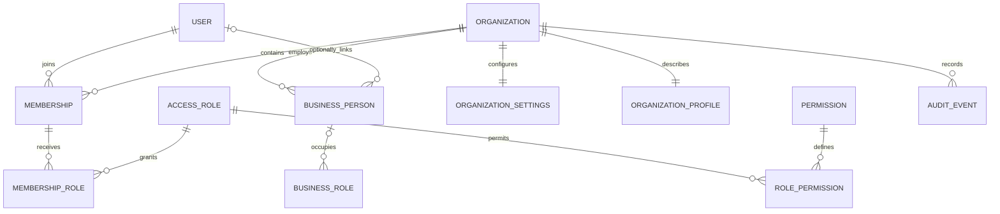
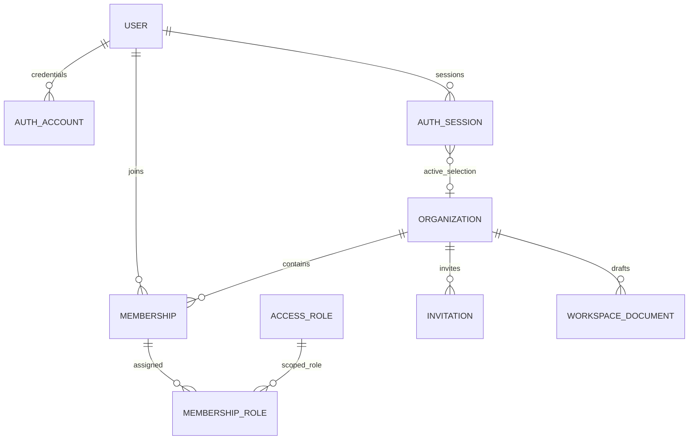

# Growth Engine — Builds 7A–7B data architecture

## BUILD 7D approved source-of-truth checkpoint

| Data | APP_MODE=local | APP_MODE=saas |
| --- | --- | --- |
| Assessment | Existing localStorage model | PostgreSQL assessment entity records |
| System | Existing localStorage model | PostgreSQL System entity records |
| Strategy | Existing localStorage model | PostgreSQL Strategy entity records |
| Scale | Existing localStorage model | PostgreSQL Scale entity records |
| Agent artifacts | Existing localStorage model | PostgreSQL Agent records, preserving personal scope |
| Authorized Agent proposals/approvals | Existing local model | Existing scoped authorization tables |
| Authentication, membership, RBAC | Not applicable | Fresh server/PostgreSQL authority |
| UI preferences | Browser | Browser allowed |

SaaS has no localStorage fallback or dual write. Legacy workspace documents remain recovery archives and coordination-version holders. Nested history payloads are preserved. Full historical pagination, rich golden parity and complete operational SaaS export remain outstanding. Agent business execution remains disabled. See [the current checkpoint](BUILD-7D-CONTINUATION.md); later sections document earlier phases.

Build 7A supplies the server persistence foundation. Build 7B adds real Better Auth accounts/sessions, company creation/selection, memberships, secure invitations and tenant-bound UI storage. Normal `APP_MODE=saas` requires authenticated server identity. Explicit `APP_MODE=local` preserves the existing browser workspace for development/migration. No browser data is automatically imported or replaced. Full module RBAC, normalized domain UI adapters, invitation email delivery and server Agent execution remain subsequent work; see [Build 7B's completion report](BUILD-7B.md).

## Technology and boundary

Production target: PostgreSQL 17, Drizzle ORM 0.45.3, node-postgres 8.23.1. Explicit SQL migrations are committed under `drizzle/`; generated SQL is reviewed, rather than synchronizing a production schema with `push`. PostgreSQL gives transactions, composite foreign keys, relational constraints and indexes. Drizzle keeps types close to the schema and supports both the server PostgreSQL driver and the development test driver.

This workstation has no PostgreSQL tools or Docker. PGlite 0.5.8 runs the actual PostgreSQL engine compiled to WebAssembly, with the same committed migrations, for integration tests and a disposable filesystem development database. It is neither SQLite nor a mock. It is not the production server or a substitute for validating TCP connectivity, independent concurrent clients, deployment permissions, backups or operational performance. Sources: [Drizzle PostgreSQL](https://orm.drizzle.team/docs/get-started-postgresql), [Drizzle migrations](https://orm.drizzle.team/docs/migrations), [PGlite](https://pglite.dev/docs/about).

`lib/server/` is guarded with `server-only`. Production connections require `PERSISTENCE_MODE=database` and a server-only `DATABASE_URL`; the pool singleton contains no selected organization or organization data cache. PGlite is used only by development scripts/tests. Setting this mode does not migrate the existing screens to the database.

## Identity and membership



Users hold identity and external authentication references, never a global business access role or a password. User statuses are Active, Invited, Suspended and Disabled. Organizations hold name, unique slug, legal/industry/model/location/currency/timezone information and Active, Trial, Suspended or Archived status. Profiles hold business metadata; settings hold locale, timezone, currency, fiscal year, week start, date format and brand settings.

Membership is unique for `(organizationId, userId)` and has Invited, Active, Suspended or Removed status. Each membership receives organization-owned access roles through membership-role rows. Ali can be Owner in Alpha and Consultant in Beta. Invited, suspended, removed or disabled identities cannot resolve an active context. Removing a membership does not delete company records or historical authorship. No role-management endpoints or last-owner removal operation are exposed in 7A; protecting the last Owner must precede those operations in 7C.

AccessRole controls SaaS access. BusinessRole models operational responsibility, department, reporting relationships and Person assignment. A Person can exist without a login. Assigning a BusinessRole never grants SaaS access. Invitations contain scoped intended roles, hashed token, expiry, inviter and status; email delivery and acceptance are not implemented.

The six initial roles are Owner, Admin, Consultant, Manager, Editor and Viewer. Permission keys cover organization, membership, roles, audit, System, Strategy, Scale and Agent. Exact initial grants are in `lib/server/permissions.ts`. Owner has every permission; Admin excludes access-role management; Consultant/Manager can edit business records and prepare/approve recommendations, but cannot execute Agent actions; Editor can edit and prepare; Viewer has view permissions. These are defaults, not complete production RBAC or department-level policy. `strategy.edit` never implies `agent.execute`.

## Scope and authorization

Every business table owns `organization_id`; the explicit global exceptions are Users, Organizations (the tenant root), Permissions, default GrowthLevers and UserPreferences. Composite `(organization_id, id)` uniqueness and composite foreign keys prevent tenant-crossing relationships for relational references. Membership-role assignment, process owners, cycles/objectives, experiments/constraints and Agent actor/approval bindings are covered by real database tests. Scoped indexes serve tenant queries. Soft archives and versions preserve operational history.

Repositories require a validated organization UUID and add scope to every list and ID lookup. They are low-level trusted server components, not authentication entry points. Services re-resolve active User, Membership, Organization, roles and permissions on every operation. Context is immutable and never comes from client role/permission arrays. `AuthenticatedActorResolver` is the interface for the trusted identity provider in 7B. Organization ID from a request is only a selection: membership must be checked before access.

There is no PostgreSQL row-level security policy in 7A. Application services enforce authorization, composite foreign keys enforce scoped relationships, and raw administrative SQL remains privileged. Database RLS and least-privilege production credentials require a separate deployment/authorization decision. Tests must continue at that boundary before production exposure.

## Domain schema and service coverage

The inventory in `DATA-INVENTORY.md` was written before creating the schema. There are 106 tables covering identity/access, assessment, System organization/process design/standards/measurement, Strategy cycles/objectives/key results/initiatives/reviews, Scale ideas/experiments/funnel/channels/loops/readiness and Agent workspace/actions/evidence/history.

Canonical editable entities and important relationships use relational columns. Frozen historical snapshots, heterogeneous evidence, provider payloads and the staged original local archive use JSONB deliberately. Derived health, priority, readiness and diagnosis calculations remain in the established pure domain functions; no second scoring system was introduced. Historical JSONB is not a promise that all old UI records are already normalized or server-editable.

Organization, System, Strategy, Scale and Agent repositories are the first scoped adapters. Read services cover representative process/objective/experiment/session lists. Transactional Strategy draft creation reuses the existing `saveObjective` domain validator; it creates one objective and audit event with one idempotency reservation. Title updates use compare-and-swap version checking. Agent session creation demonstrates server actor ownership. Full CRUD and UI routing for all 106 tables remain subsequent adapter work. Polymorphic evidence/context references are scoped metadata; future writes must validate the selected artifact inside the same tenant. Same-map step relationships and matching initiative objective/key-result relationships likewise require domain validation before adding server editors.

## Transactions, history and Agent safety

Organization bootstrap creates Organization, Active Owner Membership, six default scoped roles and their permission grants, Owner assignment, profile, settings and audit event in one transaction. A forced mid-operation failure leaves none of those company rows behind. Seeds are transactional and repeatable.

Business records use positive integer versions. Updates match organization, record ID and expected version, incrementing only on success. A stale update returns Conflict. Idempotency is unique per organization, operation and key; the stored actor and request hash must match for replay. Changed payloads cannot reuse a completed key. The production PostgreSQL implementation uses these constraints and transactions; independent multi-session races remain to be validated against a running standalone server.

Agent requestedBy, approvedBy and executedBy references target actual same-tenant membership users. Approval/execution composite references bind the action, revision and binding. Audit events reject SQL updates/deletes. Completed execution records reject deletion and changes to their recorded actor, binding or payload; Succeeded may transition to RolledBack while retaining the original snapshot. Database administrators can alter triggers, so this is not operational tamper-proof storage.

There is no server Agent executor. A matching foreign key alone does not validate approval decision, expiry, high-risk rules, exact preview, current state or rollback eligibility. The existing local engine is preserved. Those checks and atomic domain-write/execution/audit transactions are mandatory when a future server executor is built. Imported local action history is provenance, never a trusted server approval.

## Persistence and migration

`LocalPersistenceProvider` retains one anonymous local workspace and the existing parsers. `DatabasePersistenceProvider` carries one explicitly authorized context and delegates to services, with no global company selection cache. The 7A contract is deliberately narrow (objective summaries plus export) rather than pretending all modules have migrated.

The version-1 local export captures all 15 allowlisted stores, including null slots, original raw values, module versions, workspace identifier, assessment profile and timestamp. Unrelated localStorage values are excluded. Backup export preserves corrupt originals; staging validates each existing parser/reader and rejects unsupported versions or blank stores. The accepted envelope strips extra fields and derives profile metadata from the actual assessment. The staged target organization and importing actor come from reauthorized server context; import is limited to 32 MiB, hash-deduplicated and transactional. Staging does not create or overwrite live business records. A later wizard must map legacy string IDs to UUIDs, detect dangling references, show a dry-run preview and handle duplicates/resume before committing.

Server export reads the selected organization's complete scoped tables in a repeatable-read, read-only transaction. It requires organization-update, membership-view and audit-view permissions. Global identities/preferences/default definitions are not included; identity mapping must be designed for portable imports. Neither export nor staged import has public UI/API exposure in 7A.

## Local setup

Install with `npm.cmd install`. `.env.example` now defaults to SaaS mode and requires a server auth secret, exact auth origin and configured database. Follow [Build 7B setup](BUILD-7B.md#running-and-accounts). Existing browser stores continue to work only in explicit `APP_MODE=local`; they are not an authentication fallback.

Disposable embedded development database, in PowerShell:

```powershell
$env:NODE_ENV = 'development'
$env:DATABASE_DRIVER = 'pglite'
npm.cmd run db:migrate
npm.cmd run db:seed
npm.cmd run db:health
```

Data persists under an ignored `.data/` directory; its parent is created automatically. Build 7B explicitly supports the embedded engine in the loopback SaaS application with `SAAS_DEV_DATABASE=true` and the same `DEV_DATABASE_PATH`. It still does not back the older Build 7A development API. Run only one embedded database process/instance at a time, and stop the application before CLI migration/seed. The current fresh authentication QA directory is `.data/postgres-saas-dev-fixed`; the older unreadable QA directory was retained.

Standalone development PostgreSQL: install Docker or PostgreSQL, set a local `POSTGRES_DEV_PASSWORD`, run `docker compose up -d`, and supply a local `DATABASE_URL` for `postgresql://growth_engine_dev:<password>@127.0.0.1:5432/growth_engine_dev`. Keep actual credentials out of source control. Set `DATABASE_DRIVER=postgresql`, `NODE_ENV=development`, run migrate/seed/health, then opt into `PERSISTENCE_MODE=database`. The included Compose service binds only loopback and persists a development volume. Docker startup was not tested on this workstation because Docker is absent.

`db:generate` generates reviewed schema migrations. `db:migrate` applies committed migrations without deleting data. `db:seed` requires development mode, and a standalone server must be loopback with a `_dev` database name. `db:reset:dev` is destructive and additionally requires `ALLOW_DEV_DB_RESET=reset-disposable-database`; it was not run. Never use it on shared or production data.

The temporary `/api/dev/saas` route has no UI and is always disabled in production. Development requires explicit APP_MODE=local, explicit enablement, a fixed server actor from the seed, a random secret of at least 32 characters in `x-saas-dev-token`, loopback host, matching POST Origin, and small validated bodies. It can check health, list memberships/objectives, bootstrap a company and create an idempotent draft objective. Request User IDs or role grants are rejected. It does not accept identity from browser storage. Do not expose it publicly. Its handlers were integration-tested directly against the real embedded database; the TCP PostgreSQL-backed development route was not run here.

## Verification and next boundary

Run `npm.cmd test` for the 847 established domain regressions and `npm.cmd run test:database` for actual PostgreSQL integration tests; no external test database is required. Also run `npx.cmd tsc --noEmit`, `npm.cmd run build` and `npm.cmd audit`.

Build 7B implements trusted authentication/session resolution, company selection, account status checks and transactional last-Owner safeguards. Later builds must add full authorization, complete normalized adapters, reviewed local migration, independent PostgreSQL concurrency tests, production operational controls and a separately reviewed server Agent executor. See `BUILD-7A.md` for the historical 38-point foundation report and `BUILD-7B.md` for the current 39-point report. Current verification is 847 prior domain tests + 31 foundation tests + 29 auth tests (907), plus production-like SaaS and explicit-local HTTP checks.

## Build 7B identity/session relationships

The schema now has 112 tables. Six additions are `auth_sessions`, `auth_accounts`, `auth_verifications`, `auth_rate_limits`, `auth_security_events` and tenant-scoped `tenant_workspace_documents`. The first five are deliberate global authentication exceptions; business permissions still require a tenant Membership. User has a framework-compatible `email_verified` field (verification delivery is not enabled).



`createAuth` uses Better Auth's Drizzle PostgreSQL transaction adapter and salted scrypt. Cookies are signed, HttpOnly, SameSite=Lax and Secure on HTTPS. Session expiry is seven days; renewal age is one day; cookie data caching is disabled. Server identity checks current User status and the unexpired session row. `activeOrganizationId` and role grants cannot be supplied at signup. `user_preferences.last_organization_id` is revalidated before being used on a new session.

The root server template guards business pages, and SaaS/auth APIs independently check identity. Proxy cookie presence is an optimization, never authorization. Tenant requests require fresh active membership; stale organization headers fail. Authenticated pages are dynamic and APIs use no-store. The SaaS shell performs full navigations/remounts to avoid retained Next parent context or browser providers after company/user changes. A process-global runtime caches only the connection/auth framework, never a User or OrganizationContext.

Company creation reuses Build 7A's atomic Owner/bootstrap transaction. Member role/status changes serialize on the organization row, use versions, prevent the last Active Owner from losing access, and retain history. Invitations store SHA-256 hashes of random 256-bit tokens, scoped roles and expiry; acceptance is email-bound and atomic. Copy-link is the only delivery flow. Owner grants are restricted to Owners. BusinessRole/System Person remains independent of login access and is never linked by display-name matching.

Each company has a validated v1 compatibility draft document (`owner_key=shared`). Agent/Advisor documents use the current User UUID as owner key and are queried by both company and user; they cannot leak another user's conversation context. The server validates all store keys/payload parsers, coarse write grants and both version counters. This transitional JSONB adapter makes existing screens tenant-bound without claiming complete normalized CRUD or migrating old browser data. Legacy Agent execution/rollback is blocked in SaaS mode; trusted server execution is a separate future boundary.

Auth security events contain only actor User when known, action, outcome and time. Tenant AuditEvents include organization, authenticated actor and target membership/User as applicable. Credential hashes and raw tokens are never audit metadata. The verification model is reserved for future email-backed reset/verification; no reset bypass endpoint exists. Production reverse proxies must supply a trusted client IP for the database-backed rate limiter and must discard spoofed forwarding headers.
# 7D progress notice

Backup schema 2 and explicit migration preview/lifecycle are implemented. Canonical domain normalization and import execution are still in progress. The current SaaS workspace bridge remains the operational database source; see `SERVER-DOMAIN-ARCHITECTURE.md` and `DATA-MIGRATION.md` for the exact boundary. No automatic local upload, local clearing or server Agent execution has been added.
